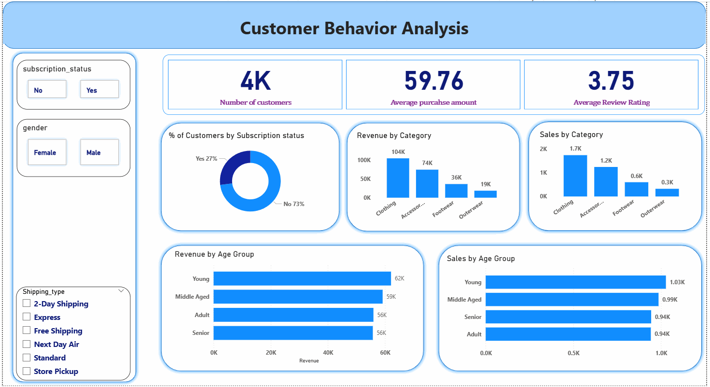

# Customer Shopping Behaviour Analysis

**Python • Databricks SQL • Power BI** | Retail customer analytics | Portfolio project

## Business question
How can a retail business use customer shopping records to understand purchase behaviour, evaluate subscription and discount patterns, and prioritise product and customer strategies?

## Key results

| Metric | Result |
|---|---:|
| Purchase records / unique customer IDs | **3,900 / 3,900** |
| Total recorded purchase value | **$233,081** |
| Average purchase amount | **$59.76** |
| Average review rating (after imputation) | **3.75 / 5** |
| Clothing category purchase value | **$104,264** (44.7% of total) |
| Subscriber proportion | **27.0%** (1,053 of 3,900) |
| Purchase records using a discount | **43.0%** (1,677 of 3,900) |

## What was done

1. **Python / pandas:** Inspected 18 original fields, resolved 37 missing review ratings using category medians, standardised column names and derived age quartiles.
2. **Databricks / Spark SQL:** Converted the data to a Spark DataFrame and SQL view, then analysed purchase value, ratings, subscription, discounts and product rankings using `GROUP BY`, `CASE`, CTEs and window functions.
3. **Delta + Power BI:** Used the persistent `workspace.default.customer_powerbi` table for an interactive Power BI dashboard, with customer, category, shipping and subscription filters.
4. **Business interpretation:** Developed cautious, testable recommendations for category planning, subscriber engagement and discount governance.

## Selected insights

- **Category concentration:** Clothing accounts for $104,264 across 1,737 records, the largest category by purchase value and frequency.
- **Subscription:** Subscribers average $59.49 per observed purchase versus $59.87 for non-subscribers; the data does *not* show higher average spending among subscribers.
- **Discounts:** 43.0% of purchase records show a discount. A hat has the highest item-level discount application rate (50.0%). The dataset lacks margin and counterfactuals, so this is not evidence of discount effectiveness.
- **Shipping:** Express averages $60.48 per purchase and Standard $58.46; these are descriptive associations, not causal shipping effects.
- **Ratings:** Gloves have the highest item-level mean review rating (3.86), based on imputed and observed review values.

## Dashboard

The Power BI report includes three KPI cards, category and age-group purchase-value/count visuals, subscription breakdown, and four slicers. [Download the editable Power BI dashboard](dashboard/Customer_Behavior_Analysis_dashboard.pbix) and open it with Power BI Desktop.

*Dashboard preview from the updated screenshot. Download the `.pbix` above to explore the interactive report in Power BI Desktop.*

## Repository files

| File | Purpose |
|---|---|
| [`notebooks/customer_behavior_analysis.ipynb`](notebooks/customer_behavior_analysis.ipynb) | Streamlined Databricks notebook (outputs cleared) |
| [`sql/customer_shopping_analysis.sql`](sql/customer_shopping_analysis.sql) | Clean, commented Databricks SQL queries |
| [`dashboard/Customer_Behavior_Analysis_dashboard.pbix`](dashboard/Customer_Behavior_Analysis_dashboard.pbix) | Editable Power BI report (latest supplied version) |
| [`dashboard/dashboard_preview.png`](dashboard/dashboard_preview.png) | Preview of the updated Power BI dashboard |
| [`reports/Customer_Shopping_Behaviour_Report.md`](reports/Customer_Shopping_Behaviour_Report.md) | Readable report, findings and recommendations (PDF and DOCX in accompanying package) |
| [`docs/analysis_validation_notes.md`](docs/analysis_validation_notes.md) | Verification, assumptions and limitations (original brief in accompanying package) |

## Reproducibility

The notebook expects `customer_shopping_behavior.csv` to be available in Databricks; the raw CSV is not included in this repository package. Update the notebook’s `csv_path` and, if applicable, the catalog/schema for the Delta table. The Power BI file may require updating data-source credentials on another machine.

**Analysis limitations:** The data provides a cross-sectional shopping snapshot without purchase dates, profit margins, discount amounts or observed responses to marketing. The labels *New*, *Returning* and *Loyal* are proxy segments based on `previous_purchases` thresholds, not validated retention outcomes. Findings should not be interpreted as causal or generalised outside the dataset.
