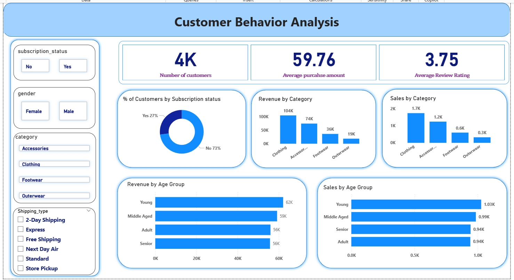

# Power BI Dashboard

The **Customer Shopping Behaviour Dashboard** is now available in this folder:

- [Open / download the Power BI file](Customer_Behavior_Analysis_dashboard.pbix)
- [View the correct dashboard screenshot](dashboard_preview.png)

*The `.pbix` is the editable report; the PNG is a static preview and will not update automatically when the local Power BI report changes. Open the report in Power BI Desktop to test slicer interactions. Keep the uploaded PBIX and preview image in sync.*

## Dashboard contents

This is an interactive, one-page **Power BI Desktop** report backed by data prepared in Python and Databricks SQL. Filters include subscription status, gender, product category and shipping type.

- 3,900 purchase records and average spend of $59.76
- 3.75 average review rating after imputation
- 27.0% subscriber share
- Purchase value and counts by category and age group
- Slicers for subscription, gender, category and shipping type

Count-based visuals use **Count of Customer ID** rather than Sum. Power BI may request updated Databricks credentials when the PBIX is opened on a different computer.
